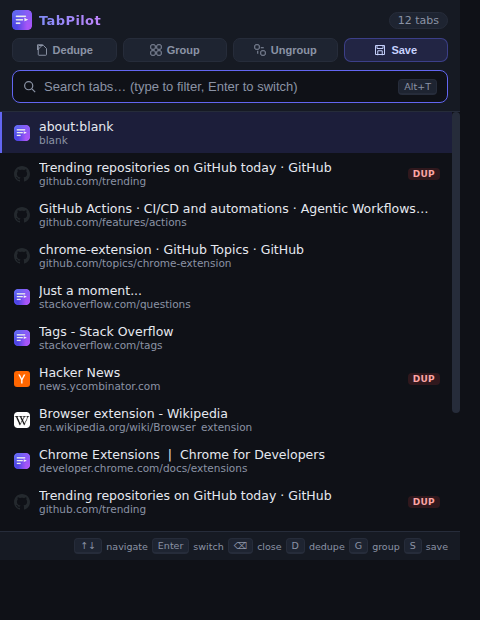

<p align="center">
  
</p>
<h1 align="center">TabPilot</h1>
<p align="center">
  <strong>Search, dedupe, group and save your Chrome tabs — keyboard-first, zero clutter.</strong>
</p>
<p align="center">
  <a href="https://github.com/Abdulcool/tabpilot/actions"></a>
  
  
  
</p>

---

<p align="center">
  
  <br/>
  <em>Every tab across every window, duplicates flagged in red. Type to filter, Enter to jump.</em>
</p>

## Why TabPilot?

If you live with 40+ tabs open, the browser itself becomes the mess. TabPilot is a
small, fast, privacy-respecting extension that gives you four superpowers:

| Feature | What it does |
| --- | --- |
| 🔍 **Instant fuzzy search** | Filter all open tabs across every window as you type. `gh pr` finds your GitHub pull requests. Enter jumps straight to the tab. |
| 🗑 **Duplicate killer** | One click (or `Alt+Shift+D`) closes every tab that is open more than once — keeping the pinned or active copy. |
| 🗂 **Auto-grouping** | Groups tabs by site into labeled, color-coded tab groups (`Alt+Shift+G`). Ungroup everything just as fast. |
| 💾 **Sessions** | Snapshot all windows into a named session. Restart the browser, restore everything in one click. |

Plus a live **tab-count badge** on the toolbar that turns amber over 20 tabs and red
over 50 — a quiet nudge before things get out of hand.

## Install (unpacked)

1. Clone this repo or download a release zip and unzip it.
2. Open `chrome://extensions`.
3. Enable **Developer mode** (top right).
4. Click **Load unpacked** and select the repo folder.
5. Press **Alt+T** anywhere. Done.

## Keyboard shortcuts

| Shortcut | Action |
| --- | --- |
| `Alt+T` | Open TabPilot |
| `↑` / `↓` | Move selection |
| `Enter` | Switch to the selected tab |
| `Backspace` (empty search) | Close the selected tab |
| `D` / `G` / `U` / `S` | Dedupe / Group / Ungroup / Save session |
| `Alt+Shift+D` | Close duplicate tabs (global) |
| `Alt+Shift+G` | Group tabs by site (global) |
| `Esc` | Close the popup |

Shortcuts can be remapped at `chrome://extensions/shortcuts`.

## Privacy

TabPilot never leaves your machine. There are **no network calls, no analytics, no
dependencies** — the entire extension is plain, readable JavaScript. It asks for the
minimum permissions it needs:

- `tabs` — read and close your tabs
- `tabGroups` — create/remove tab groups
- `storage` — keep saved sessions locally

## Development

Zero build step. Edit the files in `src/`, hit reload at `chrome://extensions`.

```bash
# logic test suite (node:test, no dependencies)
node --test tests/

# sanity checks: manifest validity, referenced files, syntax
node scripts/lint.mjs
```

```
├── manifest.json          # MV3 manifest
├── icons/                 # generated toolbar/store icons
├── src/
│   ├── popup.html/.css/.js   # the popup UI
│   ├── background.js         # badge, global shortcuts
│   └── lib/
│       ├── core.js           # pure logic: search, dedupe, grouping, sessions
│       └── actions.js        # thin chrome.* API wrappers
├── tests/                 # unit tests for logic + API wrappers (mocked chrome)
└── scripts/               # dev tooling
```

The architecture deliberately separates **pure logic** (`core.js` — testable in Node,
no `chrome.*`) from **thin API wrappers** (`actions.js`), which keeps the test suite
fast and honest: 34 tests, no browser required.

## Releasing

Tag a version and CI builds a store-ready zip:

```bash
git tag v1.0.0 && git push --tags
```

## License

MIT — see [LICENSE](LICENSE).
